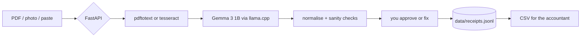

# Quiet Ledger

A local-first receipt and invoice sorter for people who bill by the hour and
would rather not hand their client data to another SaaS.

Drop a PDF, a photo, or paste the receipt text. Gemma 3 1B reads it on your own
machine, drafts the bookkeeping entry, and you confirm it before it lands in the
CSV you send your accountant.

Recommended entry for **Hacktoberfest Open-Source AI Challenge: Week 2** (theme:
Side Hustle). Everything that makes it work is open: BirdNET-style offline
inference, open weights, no API key.

## What it does

- Reads PDF invoices, photos of receipts, and pasted text.
- Extracts vendor, date, total, tax, currency, category, payment method, and
  invoice number with an open-weight model running locally.
- Never uploads the file, the text, or the extracted record.
- Keeps everything in `data/receipts.jsonl`, a plain file you own.
- Lets you correct every field before it counts, because a 1B model is a
  draftsman, not an accountant.
- Exports a CSV with stable columns for your accountant or your tax return.
- Deduplicates by file hash so re-dropping the same receipt does nothing.
- Installs as a PWA and still opens the shell offline.

## Why open matters here

A receipt is one of the most sensitive documents a small business has. It names
your clients, your suppliers, your prices, and where you were on a given day.
Every cloud sorter needs that document on someone else's server.

Running the model locally means the receipt never leaves the laptop. It also
means the tool works in a market stall with no signal, costs nothing per
document, and can be changed: swap the quantisation, move to a larger Gemma, or
fine-tune on the vendors you actually use.

The model is not the product. The record you approve is the product.

## Quick start

```bash
make install          # virtualenv + dependencies
make models           # Gemma 3 1B, Q4_K_M, ~0.8 GB
make llama            # builds llama-cli from source (needs cmake)
export LLAMA_BIN="$PWD/.llama.cpp/build/bin/llama-cli"
make run              # http://127.0.0.1:8000
```

No model yet? The app still runs. It falls back to a conservative parser and
labels every entry `fallback-parser`, so you can see the workflow before
downloading weights.

### Faster llama.cpp

If you would rather not compile, grab a prebuilt release for your platform from
the [llama.cpp releases](https://github.com/ggml-org/llama.cpp/releases) and
point `LLAMA_BIN` at its `llama-cli`.

## Configuration

| Variable | Default | Purpose |
| --- | --- | --- |
| `LLAMA_BIN` | `llama-cli` | Path to the llama.cpp CLI binary |
| `GEMMA_MODEL` | `models/gemma-3-1b-it-Q4_K_M.gguf` | Local GGUF model |
| `LLAMA_THREADS` | half the CPU count | Inference threads |
| `MODEL_TIMEOUT` | `180` | Seconds before giving up on one document |
| `QUIET_LEDGER_DATA` | `./data` | Where receipts are stored |

## How it works



- **PDFs** go through `pdftotext`. Scanned PDFs and photos go through
  `tesseract` when it is installed.
- **Gemma 3 1B** (`Q4_K_M`, about 0.8 GB) reads the text through `llama-cli`
  with a strict JSON-only prompt at temperature 0.
- **Normalisation** is not optional. A model will happily return `16%` as the
  tax, a subtotal as the total, or `M-PESA` as three different strings. The
  normaliser turns dates into ISO, amounts into numbers, rejects a tax rate in
  the tax field, prefers the printed amount due over a model subtotal, and
  maps categories onto a fixed list.
- **The approval step** is the point. Every field is editable, and the CSV
  contains what you confirmed, not what the model guessed.

## API

| Method | Path | Purpose |
| --- | --- | --- |
| `GET` | `/api/health` | Status, model readiness, categories |
| `POST` | `/api/ingest` | Upload a PDF, image, or text file |
| `POST` | `/api/text` | Paste receipt text |
| `GET` | `/api/receipts` | List, with `month`, `category`, `q` filters |
| `PATCH` | `/api/receipts/{id}` | Correct a field |
| `DELETE` | `/api/receipts/{id}` | Remove an entry |
| `GET` | `/api/export.csv` | Download the CSV, optionally by month |

## Privacy

- No telemetry, no analytics, no outbound calls in the request path.
- Files are read in memory, and only the extracted record is persisted.
- Deleting a record removes it from `receipts.jsonl`; deleting the file removes
  everything.
- The model download is the only network access, and only when you run
  `make models`.

## Known limits

- A 1B model misreads unusual layouts. That is why the app asks you to approve.
- Scanned images need `tesseract`; without it the app says so plainly.
- Multi-currency totals are summarised per currency rather than converted.
- The file format is JSON Lines, which is fine for thousands of receipts and
  honest about not being a database.

## Tests

```bash
make test
```

27 tests cover amount and date parsing, the fallbacks, deduplication, CSV
output, summary grouping, and the API's correction rules.

## License

MIT.
